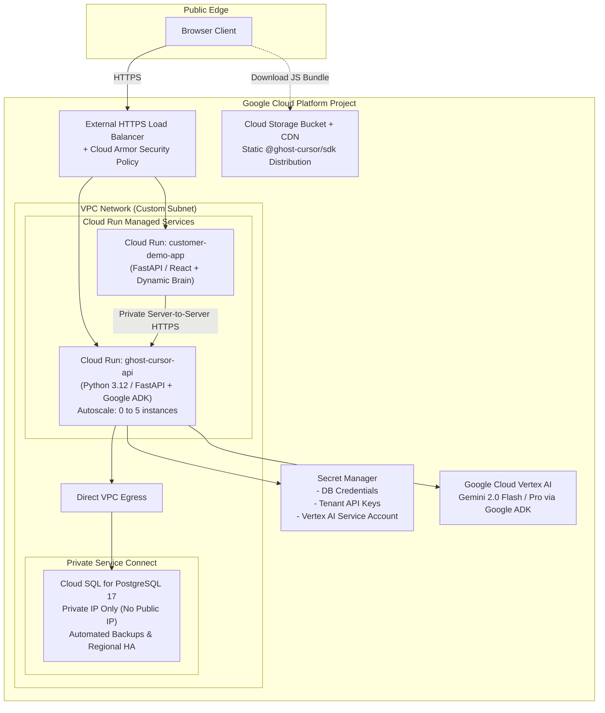

# 🚀 ACT.md — Master Technical Implementation Blueprint

> **Ghost Cursor: Application-Aware Autonomous AI Co-pilot as a Service**  
> *Consolidated single-source implementation guide synthesizing architectural directives, security bounds, GCP deployment topology, protocol specifications, Google ADK Python Agent orchestration, Frontend Tools Dispatcher, and Dynamic Page-Brain Resolution.*

---

## 1. Executive Product Architecture & Core Invariants

### 1.1 Non-Negotiable Integration Topology
Ghost Cursor strictly enforces **one and only one communication topology**:
```text
┌─────────────────────────────────────────────────────────────┐
│ Customer Web Application (User's Browser)                   │
│   ├── Host Application UI (React / Next.js / Vue / Vanilla) │
│   └── @ghost-cursor/sdk (DOM-aware executor & UI widget)    │
└──────────────────────────────┬──────────────────────────────┘
                               │ Same-origin request / WS
                               │ Existing user session & CSRF
                               ▼
┌─────────────────────────────────────────────────────────────┐
│ Customer Backend Gateway SDK (Python / Node.js)             │
│   ├── Validates customer user session                       │
│   ├── Injects Subject Identity (opaque ID)                  │
│   ├── Dynamic Brain Loader (platform.md + {page}.md)        │
│   └── Executes Local Read-Only Backend Tools                │
└──────────────────────────────┬──────────────────────────────┘
                               │ Server-to-Server HTTPS
                               │ X-Ghost-Subject + Bearer API Key
                               ▼
┌─────────────────────────────────────────────────────────────┐
│ Ghost Cursor Managed Cloud (GCP)                            │
│   ├── Cloud Run: Python 3.12 (FastAPI + Google ADK Engine)  │
│   ├── Google ADK Agent: Tool-calling with Gemini 2.0        │
│   ├── Cloud SQL: PostgreSQL 17 (authoritative run store)    │
│   └── Secret Manager: Tenant keys & model credentials       │
└─────────────────────────────────────────────────────────────┘
```

#### Absolute Boundary Invariants:
1. **Zero Browser-Direct Access:** The browser NEVER communicates directly with Ghost Cursor Cloud or any LLM provider. No API keys, secret tokens, or complete prompts reach client bundles.
2. **AI Selects Tools & Parameters; Frontend Deterministically Executes:** The LLM does not write custom code or raw DOM scripts. It receives fixed, typed tool definitions (e.g., `navigate`, `click`, `fill_input`, `guided_tour`, `clarify`). The agent calls the tool with validated parameters (`target_id`, `value`). The JSON containing the tool call parameters is sent to the client, where the Frontend SDK deterministically executes it.
3. **Pure Business Context in Brain:** Markdown Brain files contain **zero HTML tags or DOM selectors**. They contain plain English business rules, field constraints, platform definitions, and domain logic.
4. **Dynamic Page-Brain Resolution:** The Backend SDK automatically loads `platform.md` (global platform context) plus `{page}.md` (page-specific context) based on the client's current route.
5. **Local Tools are Read-Only:** Server tools run during orchestration are read-only (e.g., simulations, balance checks, ROI calculators). Mutating operations occur solely on the client DOM via approved UI actions.
6. **Approval-First Execution:** Mutating or multi-step action sequences require explicit user confirmation ("Approve and Run") prior to execution.

---

## 2. Tool-Calling Agent Architecture: Frontend Executors as Agent Tools

### 2.1 The Concept & How It Works
Instead of having the model output a freeform text plan, the Google ADK Agent is provided with a fixed set of **Frontend Action Tools** and **Backend Knowledge Tools**.

```text
┌────────────────────────────────────────────────────────────────┐
│ GOOGLE ADK AGENT IN PYTHON (Cloud Run)                         │
│                                                                │
│  Tools Provided to Agent:                                      │
│  ├── [Frontend Action Tool] navigate(target_page)              │
│  ├── [Frontend Action Tool] click(target_id)                   │
│  ├── [Frontend Action Tool] fill_input(target_id, value)       │
│  ├── [Frontend Action Tool] select_option(target_id, option)   │
│  ├── [Frontend Action Tool] toggle_switch(target_id, state)    │
│  ├── [Frontend Action Tool] guided_tour(steps)                 │
│  ├── [Frontend Action Tool] ask_clarification(question, opts)  │
│  └── [Backend Read-Only Tool] calculate_roi(assumptions)       │
│                                                                │
│  Agent Reasons ➔ Outputs Tool Call JSON:                       │
│  { "tool": "click", "parameters": { "target_id": "theme.toggle" } }
└──────────────────────────────┬─────────────────────────────────┘
                               │ JSON Tool Call Parameters
                               ▼
┌────────────────────────────────────────────────────────────────┐
│ FRONTEND SDK EXECUTOR (Browser)                                │
│                                                                │
│  Receives Tool Call ➔ Dispatches to matching JS executor:      │
│  executors["click"](params) ➔ resolves DOM ➔ animates cursor ➔ │
│  triggers native click event.                                  │
└────────────────────────────────────────────────────────────────┘
```

### 2.2 Caveats & Architectural Safeguards
While treating frontend actions as fixed agent tools is standard and robust, three key caveats must be handled:

| Caveat | What Could Go Wrong | How Ghost Cursor Solves It |
|---|---|---|
| **1. Multi-Step Execution & Route Transitions** | If the agent emits `navigate("/settings")` followed immediately by `click("theme.toggle")`, the second element does not exist on the current page yet. | **Step Readiness & Await Routing:** The Frontend Executor runs steps in sequence. When a navigation tool is called, it waits for the SPA route change to complete and polls/waits for the next target to mount before executing the next tool call. |
| **2. Unrecoverable DOM Failure** | An element might be disabled, hidden in a collapsed drawer, or unmounted. | **Safe Execution Reporting:** The frontend reports execution status back to the backend. If an element cannot be resolved within 5s, execution halts safely without corrupted state and asks the user for help. |
| **3. Security & Injection via Tool Parameters** | A compromised agent prompt could pass malicious scripts into `fill_input` or navigate to an external phishing URL. | **Target Resolution Whitelist & Protocol Sanitization:** The frontend resolves targets exclusively via customer-registered logical IDs (never raw selectors or arbitrary URLs). URLs are restricted to same-origin SPA routes. |

---

## 3. Dynamic Private Brain Standard & Folder Structure

### 3.1 Standardized Folder Structure
The customer maintains a dedicated directory in their codebase:
```text
your-backend-app/
└── brain/
    ├── platform.md                 # 🌐 Global platform context (always loaded)
    └── pages/                      # 📄 Page-specific context (dynamically loaded)
        ├── dashboard.md
        ├── settings.md
        ├── checkout.md
        ├── products.md
        └── assumptions.md
```

### 3.2 What Goes in the Brain (Pure Business Context)
The Brain contains **zero technical tags, CSS selectors, or HTML elements**. It describes what things mean in business terms so the agent knows what values to generate.

#### Example `brain/platform.md` (Global):
```markdown
# ShopHive Platform Overview
ShopHive is a modern footwear store. All currency is USD ($).
Free shipping applies automatically on orders over $50.
Standard return policy is 30 days.
Available system themes: "light" and "dark".
```

#### Example `brain/pages/settings.md` (Page-Specific):
```markdown
# Settings Page Context
This page manages user preferences and notifications.
- Appearance: Supports switching between Light and Dark mode.
- Notifications: Email alerts are enabled by default; users can toggle SMS or Push alerts.
- Shipping Address: Requires valid street address, city, state, and 5-digit US zip code.
```

### 3.3 Dynamic Brain Resolution in the Customer Backend SDK
The Backend SDK automatically reads `platform.md` and dynamically appends `{page}.md` based on `context.page` sent from the browser:

```python
# ghost_cursor/brain_loader.py
import os
from pathlib import Path

class BrainLoader:
    def __init__(self, brain_dir: str):
        self.brain_path = Path(brain_dir)

    def load_context(self, current_page: str) -> str:
        """Loads platform.md + {current_page}.md dynamically."""
        context_parts = []

        # 1. Always load platform-wide context
        platform_file = self.brain_path / "platform.md"
        if platform_file.exists():
            context_parts.append(f"### GLOBAL PLATFORM CONTEXT:\n{platform_file.read_text(encoding='utf-8')}")

        # 2. Dynamically load page-specific context
        if current_page:
            # Prevent directory traversal attacks
            safe_page = os.path.basename(current_page).lower()
            page_file = self.brain_path / "pages" / f"{safe_page}.md"
            if page_file.exists():
                context_parts.append(f"### CURRENT PAGE CONTEXT ({safe_page}):\n{page_file.read_text(encoding='utf-8')}")

        return "\n\n".join(context_parts)
```

---

## 4. Google Agent Development Kit (ADK) Implementation

### 4.1 Python ADK Agent Definition (`services/orchestrator/app/agent.py`)
```python
from google.adk.agents.llm_agent import Agent
from google.adk.tools import FunctionTool
from typing import List, Dict, Any

# Define the fixed Frontend Executor Tools
def navigate(target_page: str, explanation: str) -> dict:
    """Navigate to another page within the application."""
    return {"action": "navigate", "target_page": target_page, "explanation": explanation}

def click(target_id: str, explanation: str) -> dict:
    """Click a registered button, link, or tab."""
    return {"action": "click", "target_id": target_id, "explanation": explanation}

def fill_input(target_id: str, value: str | int | float, explanation: str) -> dict:
    """Type or set a value in a registered input or textarea."""
    return {"action": "fill_input", "target_id": target_id, "value": value, "explanation": explanation}

def toggle_switch(target_id: str, state: bool, explanation: str) -> dict:
    """Toggle a switch or checkbox to true or false."""
    return {"action": "toggle_switch", "target_id": target_id, "state": state, "explanation": explanation}

def guided_tour(steps: List[Dict[str, str]]) -> dict:
    """Run an interactive guided tour spotlighting elements with explanations."""
    return {"action": "guided_tour", "steps": steps}

def ask_clarification(question: str, options: List[str]) -> dict:
    """Ask the user a clarifying question before proceeding."""
    return {"action": "ask_clarification", "question": question, "options": options}

def create_ghost_agent(brain_content: str, available_targets: list, current_context: dict) -> Agent:
    """Instantiates the Google ADK Agent with dynamic brain context and fixed tools."""
    
    instruction = f"""
    You are Ghost Cursor, an autonomous UI co-pilot.
    You assist users by invoking frontend action tools to operate the web interface.
    
    ### BUSINESS KNOWLEDGE:
    {brain_content}
    
    ### REGISTERED AVAILABLE UI TARGETS:
    {available_targets}
    
    ### LIVE CLIENT CONTEXT:
    Current Page: {current_context.get('page')}
    Values on Screen: {current_context.get('values')}
    
    ### RULES:
    1. Only use target IDs that are explicitly registered.
    2. If an action requires moving to another page first, invoke 'navigate' before interacting with page targets.
    3. If user intent is ambiguous or missing required fields, invoke 'ask_clarification'.
    """

    return Agent(
        name="ghost_cursor_orchestrator",
        model="gemini-2.0-flash",
        instruction=instruction,
        tools=[
            FunctionTool(navigate),
            FunctionTool(click),
            FunctionTool(fill_input),
            FunctionTool(toggle_switch),
            FunctionTool(guided_tour),
            FunctionTool(ask_clarification)
        ]
    )
```

---

## 5. End-to-End Walkthrough: "Turn the Appearance to Dark Mode"

### 5.1 Flow Diagram

```mermaid
sequenceDiagram
    autonumber
    actor User as 🧑 User
    participant SDK as 💻 @ghost-cursor/sdk (Browser)
    participant DOM as 🖥️ Client Web App DOM
    participant GW as 🏢 Customer Backend Gateway
    participant Cloud as ☁️ Ghost Cursor Cloud (FastAPI)
    participant ADK as 🤖 Google ADK (Gemini 2.0)

    User->>SDK: Types "turn the appearance to dark mode"
    SDK->>DOM: Scan current screen context
    DOM-->>SDK: Context: {page: "dashboard", values: {theme: "light"}}
    SDK->>GW: POST /api/ghost (Context + Message)
    
    Note over GW: Dynamic Brain Loader:<br/>Loads brain/platform.md + brain/pages/dashboard.md
    GW->>Cloud: POST /v1/runs (Brain + Context + Message)
    
    Cloud->>ADK: Run Agent Loop
    Note over ADK: Reasoning:<br/>1. User wants Dark Mode.<br/>2. Current page is 'dashboard'.<br/>3. Platform Brain specifies dark mode is in settings.<br/>Calls Tool: navigate("settings")<br/>Calls Tool: toggle_switch("theme.toggle", true)
    ADK-->>Cloud: Tool Calls JSON: [navigate, toggle_switch]
    Cloud-->>GW: Return Tool Plan JSON
    GW-->>SDK: WebSocket / SSE Stream
    
    SDK->>User: Displays: "I will switch to Dark Mode. Approve?"
    User->>SDK: Clicks "Approve and Run"
    
    rect rgb(30, 40, 60)
    Note over SDK,DOM: Fixed Frontend Executors Dispatch
    SDK->>DOM: executors["navigate"]("settings") ➔ SPA route changes to /settings
    SDK->>DOM: Await readiness of target "theme.toggle"
    SDK->>DOM: executors["toggle_switch"]("theme.toggle", true)
    SDK->>DOM: Animate cursor to toggle & dispatch native click
    DOM-->>SDK: React/CSS Theme updates to Dark Mode
    end
    
    SDK-->>User: Confirmation in chat: "Theme switched to Dark Mode 🌙"
```


### 5.2 Frontend Executor Dispatcher (`packages/sdk/src/interactions.ts`)
```typescript
export const executors: Record<string, (params: any) => Promise<void>> = {
  navigate: async ({ target_page }) => {
    // 1. Trigger client router or click navigation target
    const link = document.querySelector(`[data-ghost-nav="${target_page}"]`) as HTMLElement;
    if (link) {
      await animateCursorTo(link);
      link.click();
    } else {
      window.history.pushState({}, '', `/${target_page}`);
      window.dispatchEvent(new PopStateEvent('popstate'));
    }
  },

  click: async ({ target_id }) => {
    const el = await resolveTargetWithWait(target_id);
    await animateCursorTo(el);
    el.click();
  },

  fill_input: async ({ target_id, value }) => {
    const el = await resolveTargetWithWait(target_id) as HTMLInputElement;
    await animateCursorTo(el);
    setNativeValue(el, value);
  },

  toggle_switch: async ({ target_id, state }) => {
    const el = await resolveTargetWithWait(target_id) as HTMLInputElement;
    await animateCursorTo(el);
    if (el.checked !== state) {
      el.click();
    }
  }
};
```

---

## 6. GCP Production Deployment Architecture



---

## 7. Verification & Automated Acceptance Checklist

```bash
# 1. Monorepo Installation & Schema Verification
npm ci
npm run schemas
npm run typecheck

# 2. Python ADK Agent Tests & Brain Loader Tests
cd services/orchestrator
python -m pytest tests/

# 3. Local Run Store & Browser E2E Test
docker compose up -d --wait
npm test
npm run test:browser

# 4. GCP Deployment Verification
gcloud builds submit --config cloudbuild.yaml
gcloud run deploy ghost-cursor-api \
  --image us-central1-docker.pkg.dev/${GCP_PROJECT}/ghost-cursor/api:latest \
  --region us-central1 \
  --vpc-egress private-ranges-only
```

---

*Ghost Cursor: Transform passive user assistance into autonomous, screen-aware execution powered by Google ADK and Gemini.*
